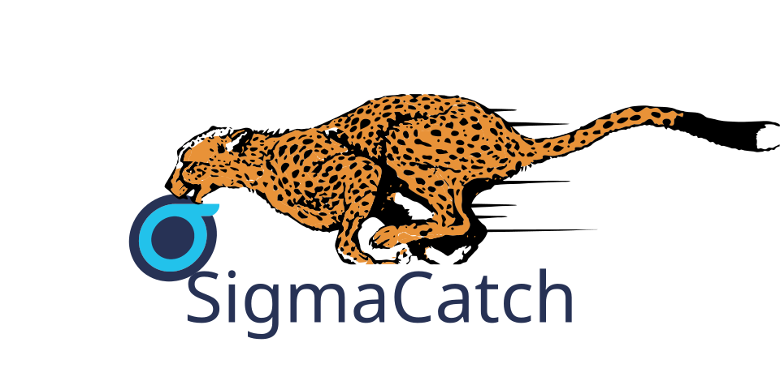

<!-- SPDX-License-Identifier: MIT -->
<!-- SPDX-FileCopyrightText: 2026 sigmacatch contributors -->
<!-- markdownlint-disable MD033 MD041 -->
<p align="center">
  <picture>
    <source media="(prefers-color-scheme: dark)" srcset="docs/media/logo-dark.svg">
    
  </picture>
</p>

<h1 align="center">sigmacatch</h1>

<p align="center">
  <a href=".github/workflows/ci.yml"></a>
  <a href=".github/workflows/release.yml"></a>
  <a href="https://frack113.github.io/sigmacatch/"></a>
  <a href="https://github.com/frack113/sigmacatch/releases"></a>
  
  <a href="LICENSE"></a>
</p>
<!-- markdownlint-enable MD033 MD041 -->

> ⚠️ **WIP** — under active development. APIs, config and output formats may
> change without notice. Not production-ready.

Real-time Sigma matcher: it captures Windows (Event Log, native ETW, kernel
driver), Linux (auditd, syslog, Sysmon, eBPF) and macOS (Endpoint Security)
events, evaluates SigmaHQ rules, and writes regression data ready for
SigmaHQ pull requests.

## Quick start

```bash
git clone https://github.com/frack113/sigmacatch.git
cd sigmacatch
cargo build --release -p sigmacatch   # default features: Windows live Event Log
./target/release/sigmacatch           # first run writes config.yaml, then stops
```

The first run writes a `config.yaml` with placeholder values and exits; fill
it in and run again. The full path — every input feature, offline mode, fork
setup — is in [Getting started](docs/getting-started.md).

## Documentation

**https://frack113.github.io/sigmacatch/** — source in [`docs/`](docs/).

- [Getting started](docs/getting-started.md) — build and first run
- [CLI](docs/user/cli.md), [configuration](docs/user/config.md),
- [`regressiondata-check`](docs/user/regressiondata-check.md),
- [troubleshooting](docs/user/troubleshooting.md)
- [Regression data](docs/regression_data/index.md)
- [Architecture](docs/dev/architecture.md),
- [Windows telemetry without Sysmon](docs/dev/windows/index.md),
- [Sysmon coverage](docs/dev/windows/coverage.md),
- [macOS support](docs/dev/macos/index.md),
- [Build](docs/dev/build.md)

## Credits

- [SigmaHQ](https://github.com/SigmaHQ/sigma) — the rule corpus.
- [EDR Telemetry](https://www.edr-telemetry.com/) — the telemetry categories
  behind the Windows coverage comparison.
- [Archify](https://github.com/tt-a1i/archify) — the interactive diagrams.

## Contributing

See [CONTRIBUTING.md](CONTRIBUTING.md).

## Security

Report vulnerabilities privately — see [SECURITY.md](SECURITY.md).

## License

MIT.

## Version history

See [docs/changelog.md](docs/changelog.md).
