# Architecture

Sigmacatch is a real-time Sigma matcher: it captures OS events, evaluates them
against the SigmaHQ rules of the cloned repo, and writes regression data back
into that repo. Four diagrams give the overview; each section details one
subsystem.


## Overview

A single binary `sigmacatch` (plus the standalone `regressiondata-check` binary)
assembles five building blocks:

1. **Inputs** — OS adapters (Winevt, EVTX, auditd, syslog, Sysmon, eBPF);
2. **Shared pipeline** — one unique `run()` for live and one-shot inputs;
3. **Detection** — `DetectionEngine` (pipelines, bloom, logsource) over the
   `SigmahqRules` rules;
4. **Regression** — `SigmahqRegression`: skip set, file generation,
   `regression_tests_path` annotation;
5. **Git** — `SigmaRepo` (grit-lib wrapper): optimized clone,
   `sigmacatch/<date>` branch, per-rule commits, single push.

## Cargo workspace

The project is a single cargo package (`sigmacatch`), plus a nested nightly-only eBPF crate (`sigmacatch/ebpf`) excluded from the workspace:

```text
sigmacatch/
├── Cargo.toml                    # Workspace root
├── sigmacatch/                   # Main package (library + two binaries)
│   ├── Cargo.toml                # features: winevt (default), evtx, auditd, builtin, sysmon, ebpf
│   ├── build.rs                  # eBPF object build (Linux target + `ebpf` feature only)
│   ├── src/
│       ├── main.rs               # Dispatch: --evtx → evtx input; winevt on Windows; Linux inputs on Linux
│       ├── lib.rs                # Module declarations + re-exports (CollectorKind, run, bootstrap_repo_regression, DataFormat)
│       ├── cli.rs                # Dispatch + diagnostic subcommands: check-filter, list-rules
│       ├── runner.rs             # run<C: CollectorKind> shared pipeline + CollectorKind trait + bootstrap_repo_regression
│       ├── logging.rs            # Two-layer tracing init (stderr error/info, rolling file)
│       ├── config.rs             # Config, GitConfig, SigmaFilterConfig, LogConfig, CliArgs, parse_args, custom_channels.yaml
│       ├── types.rs              # Event, Alert, RegressionHeader, Product, EventProducer, XML parsing, phf logsource tables
│       ├── evtx_reader.rs        # Parse EVTX files → Event (cross-platform, used by both binaries)
│       ├── ebpf_common.rs        # eBPF ring buffer wire types (shared with the probe crate via #[path])
│       ├── detection/            # DetectionEngine + per-platform pipelines + channel_resolver
│       ├── rule/                 # SigmahqRules: load/filter/dedupe/remove_id + thresholds, attack, discover
│       ├── repo/                 # grit-lib wrapper: SigmaRepo, plumbing/, porcelain, branch, signing, transport
│       ├── regression/           # SigmahqRegression, InfoYml, DataFormat (evtx/log), logtype, format, evtx_writer
│       ├── inputs/               # Input adapter modules (feature × platform gate matrix in mod.rs):
│       │   ├── mod.rs            #   feature × target_os gate matrix
│       │   ├── winevt.rs         #   WinevtCollector (Event Log live, `winevt` feature)
│       │   ├── evtx.rs           #   EvtxCollector (one-shot EVTX files, `evtx` feature)
│       │   ├── channels.rs       #   Winevt collector (EvtQueryW/EvtNext/EvtRender, multi-channel)
│       │   ├── linux.rs          #   LinuxCollector + run() (any Linux feature)
│       │   ├── auditd.rs         #   auditd collector (LineHandler, grouping by event identifier, via tail)
│       │   ├── syslog.rs         #   builtin syslog collector (LineHandler per file, via tail)
│       │   ├── sysmon.rs         #   Sysmon-for-Linux collector (LineHandler, via tail, `sysmon` feature)
│       │   ├── tail.rs           #   Shared tail driver (LineHandler trait + rotation detection)
│       │   ├── sysmon_parse.rs   #   Sysmon XML parsing (`builtin` feature)
│       │   ├── ebpf.rs           #   eBPF loader + dispatch (`ebpf` feature, privileges required)
│       │   └── ebpf_event.rs     #   eBPF XML synthesis → Sysmon format + tests
│       └── bin/
│           └── regressiondata-check.rs  # Standalone cross-platform binary: regression validation (--json, --ignore, --fix, --path)
│       └── tests/                  # 16 integration tests (runner, cli, collectors, e2e)
│           └── fixtures/           # sample.xml, sample.evtx, valid-single.evtx + sigma{,_malformed,_malformed_reference,_negative}/ fixtures
│   └── ebpf/                       # Nested nightly eBPF probe crate (excluded via [workspace], bpfel-unknown-none)
│       ├── .cargo/config.toml    #   bpfel target, bpf-linker, build-std=core
│       └── src/main.rs           #   8 tracepoints: execve, exec, exit, connect, openat (enter+exit), sendto, sendmsg
```

## Inputs


A single `sigmacatch` binary is produced by the `sigmacatch` package. Cargo
features select which inputs are compiled, and `main.rs` picks the input at
runtime: the one-shot EVTX collector when `--evtx` is present, the live Winevt
collector on Windows, or the full set of compiled and available Linux inputs.
There is also the standalone cross-platform `regressiondata-check` binary
(second binary of the `sigmacatch` package):

| Input | Module | Features | Description |
|---|---|---|---|
| winevt | `sigmacatch/src/inputs/channels.rs` | `winevt` | Native Winevt API (`EvtQueryW`/`EvtNext`/`EvtRender`), multi-channel, replayable |
| evtx | `sigmacatch/src/inputs/evtx.rs` | `evtx` | One-shot `.evtx` collector (`live_capture() = false`): parse → detection → regression generation (pure-Rust EVTX writer) → commit/push, then exit |
| auditd | `sigmacatch/src/inputs/auditd.rs` | `auditd` | tail auditd (no root required) |
| syslog builtin | `sigmacatch/src/inputs/syslog.rs` | `builtin` | tails central/authpriv/cron syslog (no root required) |
| sysmon (tail) | `sigmacatch/src/inputs/sysmon.rs` | `sysmon` (implies `builtin`) | tail Sysmon-for-Linux XML (Legacy) |
| sysmon (ebpf) | `sigmacatch/src/inputs/ebpf.rs` | `ebpf` | native eBPF probes (root or CAP_BPF+CAP_PERFMON required) |

### Windows logsource and PowerShell categories

Windows rules are constrained by the `1_win_logsource.yml` pipeline
(`add_condition` on EventIDs + `change_logsource` to the service): the
PowerShell categories are bounded to their EventIDs — `ps_module` (4103),
`ps_script` (4104) to `service: powershell`; `ps_classic_start` (400),
`ps_classic_provider_start` (600) and `ps_classic_script` (800) to
`service: powershell-classic`. Without an injected `category` field on the
event, rsigma's `LogSourceExtractor` evaluates every event fail-open against
all rules.

Classic PowerShell events (400/600/800 …) emit `<Data>` elements **without** a
`Name` attribute: the parser exposes them under positional keys (`Data0`,
`Data1`, …), and `inject_logsource_fields_for` surfaces the `EventData`
content under the generic Sigma `Data` field so that `Data|contains` works
(rsigma has no dedicated `powershell_classic` field mapping).

### Linux collectors

Each one guarded by its source; no source available → bail:

- **auditd** — if `/var/log/audit/audit.log` exists: tail, linux-audit-parser
   parsing, grouping by event identifier `timestamp:sequence`, logsource
   `product:linux, service:auditd`.
- **syslog builtin** — tail of each existing file among central
  (`/var/log/messages`, `/var/log/syslog`), authpriv (`/var/log/secure`,
  `/var/log/auth.log`) and cron (`/var/log/cron`, `/var/log/cron.log`):
  RFC3164 lines, service derived from the program tag (per-file-group
  fallback: authpriv → `auth`, cron → `cron`). Lines tagged `sysmon` are
  excluded (handled by the dedicated collector).

The `sysmon` and `ebpf` features add a dedicated collector:

- **Sysmon eBPF (`ebpf` feature)** — embedded Aya probes
  (`sigmacatch/ebpf`, nightly+bpf-linker, excluded from the workspace)
  covering EID 1 process_create, EID 3 network_connect, EID 5
  process_terminate, EID 11 file_create and the DNS extension (EID 22):
  events rendered as Sysmon XML identical to the syslog path then injected
  through the same pipeline (`inject_logsource_fields_for`). Runtime
  prerequisites: root or CAP_BPF+CAP_PERFMON (refuses to start otherwise —
  `linux.rs` bails) + kernel with BTF. Image SHA256 hashes are computed
  userspace with a cache (path,mtime). A probe loading failure at runtime
  warns (`warn!`) and continues **without** the sysmon source; only a build
  with both the `ebpf` **and** `sysmon` features falls back to the
  Sysmon-for-Linux tail.
- **Sysmon-for-Linux tail (`sysmon` feature)** — central syslog lines tagged
  `sysmon` whose body is winevt XML (`parse_winevt_xml`/`_raw`)
  → logsource `product:linux, service:sysmon` via the
  `Linux-Sysmon/Operational` channel. Read-only, no Aya dependency.

Regression format: `DataFormat::Log`.

Each input defines its own `CollectorKind`
(`name()`/`mode()`/`channels()`/`build()`/`regression_format()`/`live_capture()`);
the Linux inputs share a single `LinuxCollector` defined in `linux.rs`. The
regression format is chosen by `regression_format()`: `DataFormat::Evtx` for
the winevt/evtx inputs, `DataFormat::Log` for the Linux inputs. `name()` is
`sigmacatch` for every input.

`live_capture()` is an intrinsic property of the collector, not a CLI flag: it
defaults to `true` and is only redefined by the `evtx` input (`false`).
Continuous collectors run an infinite loop bounded by the stop-file; a one-shot
collector lets `EventProducer::run()` finish, the mpsc sender drops, and
`run()` exits when `rx.recv()` returns `None`.

`tail.rs` is the shared tail driver of the Linux file collectors (auditd,
syslog builtin, sysmon): it owns the file handle, the 100 ms poll loop, the
rotation detection (dev/ino change → reopen from offset 0) and the channel,
and drives a pure `LineHandler` per collector. Each `LineHandler` turns
complete lines into events (auditd groups records by event identifier and
flushes on sequence change or idle poll; syslog emits one event per RFC3164
line excluding `sysmon` lines; sysmon parses XML bodies skipping truncated
ones). Gated by the features that do tailing.

The `evtx` input (`evtx` feature) is a `CollectorKind` with
`live_capture() = false`: it goes through the **same** shared `run()`
pipeline as the continuous collectors, in one-shot mode — enumerate the
`.evtx` files, parse each event (`evtx_reader`), feed the `DetectionEngine`,
then reuse the shared `SigmahqRegression` + `SigmaRepo` machinery to write
`DataFormat::Evtx` regression data (always via the pure-Rust EVTX writer,
never `EvtExportLog`) and commit/push it to the fork. Since
`EventProducer::run()` ends when all files are exhausted, the process stops
by itself. No `channels()`, no interval, no stop-file poller. The
`EventRecordID` field is stripped per event (event 4688 requires its absence
to trigger the imaging rule). Being 100 % pure Rust, it compiles and runs on
Linux as well.

## Shared pipeline

The `run<C: CollectorKind>` pipeline (`runner.rs`) is unique: live and
one-shot inputs go through the same loop.

```text
1. parse_args() + Config::load_with_cli("config.yaml", cli)
   └── -n/--dry-run: reduced loading (no git validation), no on-disk state
       (no config.yaml nor logs/), exit after validating the rules + the engine
2. setup_console() (Windows); runner logging::init (&config, verbose) → tracing (stderr `error` by default, `info` with `-v`, debug file)
3. ensure_dirs() → sigma repo directory + logs/
4. SigmaRepo init: set_info_user/set_info_http|ssh (+ ensure_ssh_host_config if ssh+network),
   set_signing_key (if ssh_key_path), set_git_operations(offline, contrib),
   set_remote_url(fork) → set_working_branch(<branch>) → check_remote_working_branch()
   — full no-op when offline (no `.git` required, local files used as-is)
5. SigmahqRegression::new() → set_author/max_failed_cycles/format(kind)/add_json_output
   └── existing_rules = regression.get_sigma_id() ∪ sigma_repo.pending_regression_rule_ids()
       (pending remote sigmacatch/* branches; scan skipped when offline) → HashSet<Uuid> (empty with --all-rules)
6. SigmahqRules::new() → load + dedupe; remove_id(existing_rules)
   └── filter(SigmaFilterConfig { product, min_status, min_level, author, max_rule_size }); 0 rules → bail
7. custom_map = load_custom_channel_mapping("custom_channels.yaml")
8. DetectionEngine::new(&rules)  (pipelines + bloom + LogSourceExtractor)
   └── cycle_channels = kind.channels(&engine, &custom_map)
       ├── Some(empty) (winevt with no resolved channel) → warn + return
       └── None (linux, evtx) → no channel resolution
9. Stop handlers (watch channel): Ctrl+C, plus stop-file poller (500 ms) if live_capture()
   ; output_base = <sigma_repo_path>/regression_data ; clean_partial_artifacts()
10. collector = kind.build(&cycle_channels) → tokio::spawn(collector.run(tx, stop))
    ├── sigmacatch --evtx (one-shot) → EvtxCollector.run(tx, stop): enumerates files, sends each parsed event,
   │                                  ends at exhaustion → sender dropped
   ├── sigmacatch (winevt, Windows)  → EventCollector::new(cycle_channels).run(tx, stop)
   └── sigmacatch (Linux)            → MultiCollector (all compiled and available tails in parallel, rotation detected)
11. Loop: tokio::select!
    ├── shutdown_rx (Ctrl+C, or stop file / --max-runs reached if live_capture()) → break
     ├── event from rx → engine.put_events(vec![event])
    ├── generate_interval (30 s, live_capture only) → spawn_blocking(process_and_generate) → upload_regression() if files
    └── [one-shot only] rx.recv() → None (sender dropped, collector done) → break
12. Final flush: stop collector (10 s timeout, abort otherwise) → drain remaining events (5 s timeout)
    → process_and_generate() → upload_regression() (per-rule commit) → single push if contrib
    — one-shot propagates the final upload error (non-zero exit code); live mode logs and continues
```

### Generation and upload

`process_and_generate()`:

```text
engine.process_events() → get_alerts()
    ├── empty alerts → return (no "evaluation complete" log)
    ├── regression.begin_cycle(); log stats (events_processed, matches_found, alerts_count)
    └── for each alert: regression.add(&alert) → Option<Vec<String>>
         ├── None if rule already retired / no valid id / existing info.yml
         └── Some(files) → write files + regression_tests_path + retire the rule
    └── retired_ids += regression.take_blocked() (rules blocked after N failed cycles)
    └── retired rules → rules.remove_id() → engine.reload_rules() (single batched reload)
    ↓
returns (Pipeline returned, batches: Vec<(Uuid, Vec<String>)>)
    ↓
upload_regression() → upload_rule_batches() (in sigmacatch::repo)
     ├── one commit per rule: "🧪 test: add regression data for rule {rule_id}"
     ├── commit/push failure → rollback of the local branch to the pre-batch tip
     └── ONE single push if git.contrib: true (otherwise local commits) → PR message
```

All generation runs in `spawn_blocking` (the `Pipeline` state is moved then
returned) — `EvtExportLog` retries never freeze the collection (events keep
accumulating in the mpsc channel).

### One-shot variant: `--evtx`

The `evtx` input (`live_capture() = false`) reuses the shared `run()`
pipeline: the `.evtx` file enumeration exhausts itself (mpsc sender dropped →
`rx.recv()` returns `None`), with no `channels()`, no `generate_interval` nor
stop-file poller, and `--max-runs` is ignored (`-r 0` semantics). Ctrl+C always
aborts the pass: any in-flight cycle is abandoned and the push of what has not
been committed yet is skipped.

## Git & contribution


`SigmaRepo` (grit-lib wrapper, `sigmacatch/src/repo/`) drives the whole git
cycle:

- **Optimized clone** — shallow `depth=1` + cone-mode sparse checkout (only
  `rules/`, `rules-emerging-threats/`, `regression_data/`), optional partial
  clone; the unshallow runs in the background and is forced before the push.
- **Working branch** — `sigmacatch/<date>` (configurable); the remote branch
  integrity is checked at startup, otherwise re-clone.
- **Pending-PR skip set** — the `sigmacatch/*` namespace is fetched with a
  single glob refspec: a fresh VM does not re-capture rules whose PRs are
  still open.
- **Per-rule commits** — `🧪 test: add regression data for rule {rule_id}`; on
  commit/push failure the local branch is rolled back to the pre-batch tip.
- **Single push** — if `git.contrib: true` (otherwise local commits only); the
  pull request itself is created manually after the push.
- **Offline** — `git.offline: true`: every git operation is a no-op, no `.git`
  required, local files used as-is.

## Regression data


Each matched rule adds a mirror folder of its path under
`<sigma_repo_path>/regression_data/`:

- `info.yml` — test metadata (rule id, regression header);
- `<rule_id>.evtx` — Windows (pure-Rust EVTX writer, never `EvtExportLog`);
- `<rule_id>.log` — Linux (original lines);
- `<rule_id>.json` — optional (`add_json_output`).

The rule itself is committed updated with
`regression_tests_path: regression_data/<rule_rel_path>/info.yml`. The
validity of existing data can be checked without a collector by the
standalone `regressiondata-check` binary (`--json`, `--ignore`, `--fix`,
`--path`); rules whose committed data is invalid (broken EVTX / empty text)
are excluded from the skip set and regenerated.

## Dependency graph

```text
sigmacatch (package)
├── src/runner.rs         (run<C: CollectorKind>, shared pipeline + tracing init + cli module)
├── src/config.rs         (Config, CliArgs)
├── src/rule/             (SigmahqRules: load/filter/remove_id)
├── src/detection/        (DetectionEngine: pipelines + bloom + LogSourceExtractor + resolve_channels)
├── src/regression/       (SigmahqRegression: skip set + data generation)
├── src/types.rs          (Event, Alert, RegressionHeader, Product, EventProducer, XML parsing)
├── src/repo/             (SigmaRepo, grit-lib wrapper)
├── src/evtx_reader.rs    (parse EVTX → Event)
└── serde                 (JSON serialization of diagnostic outputs)

regressiondata-check (second binary of the sigmacatch package)
├── reuses src/detection/ (DetectionEngine)
├── reuses src/rule/      (SigmahqRules: load/filter)
├── reuses src/regression/ (SigmahqRegression)
├── reuses src/types.rs   (Event)
├── reuses src/evtx_reader.rs (parse EVTX → Event)
└── linux-audit-parser       (parse auditd records → Event)
```

The `evtx_reader` module depends on `types` + the `evtx` crate.
`regressiondata-check` (regression validation, cross-platform) reuses the same
modules (`detection`, `rule`, `regression`, `types`, `evtx_reader`) with
`linux-audit-parser` (auditd) according to each entry's `LogType`. The
diagnostic subcommands (`cli.rs`) parse arguments manually and use `serde`
for their JSON outputs (always compiled).

## Design notes

- **Stop file**: `config.stop_file` (default `.sigmacatch.stop`) is polled
   every 500 ms; if the file exists, collection stops cleanly (drain + flush +
   commit of the in-flight cycle) — this is the signal to end a continuous
   run (`-r 0`) without a hard kill that would lose the in-flight cycle's
   regression data.
- **Skip set** = `HashSet<Uuid>` from `SigmahqRegression::get_sigma_id()`
  (existing info.yml + valid data) ∪
  `SigmaRepo::pending_regression_rule_ids()` (trees of remote `sigmacatch/*`
  branches: unmerged pending PRs — a fresh VM does not re-capture their
  data), built once at startup. `--all-rules` disables it. After generation,
  a rule is retired and the engine is reloaded in a single batch
  (`engine.reload_rules`). Rules whose committed data is invalid (broken EVTX
  / empty text) are excluded from the skip set → regenerated.
- **Output always in the sigma repo**:
  `<sigma_repo_path>/regression_data/<rule_rel_path>/` (`info.yml` + `.evtx`/`.log`
   data file, optional `.json`), committed to the fork if `contrib`
   (local commits otherwise). The rule path is reproduced under
  `regression_data/` (relative to the configured `sigma_repo_path`, relative
  or absolute) — the per-rule commit also carries the updated rule with
  `regression_tests_path: regression_data/<rule_rel_path>/info.yml`.
- **Observable collector**: the collector excludes nonexistent channels once
  and for all at `ERROR_EVT_CHANNEL_NOT_FOUND` (a single `error!`); each live
  channel logs "initial query OK" then a "still alive" heartbeat (60 s);
  `warn!` when events are retrieved but lost at render/parsing. The Linux
  collectors detect rotation of the tailed file (inode change) and reopen it;
  the syslog collector excludes `sysmon`-tagged lines to avoid duplicate
  events (handled by the dedicated sysmon collector).
- **Memory: `Arc`-shared payloads + single-pass parse**: the payload fields
  of `Event` and `Alert` (`event_json_raw`, `event_json`, `event_raw`,
  `event_json_raw_all`) are `Arc`-shared — cloning an event (by rule match in
  the detection engine, by channel handoff) is a reference-count
  increment, not a deep copy of the JSON tree. `parse_winevt_xml_both` parses
  the Winevt XML once (raw view for regression + transformed view for
  detection), and `Event::from_xml_injected`/`new_injected` inject the
  logsource fields (`product`/`service`/`category`) into the detection view
  **before** the `Arc` sharing: the per-event path pays for one parse and no
  deep clone of the transformed tree. Measured on a live stream at constant
  volume: −47 % working set on Windows (247→130 MB) and −19 % RSS on Linux
  (~204→164 MB). Diagrams:

  

  
